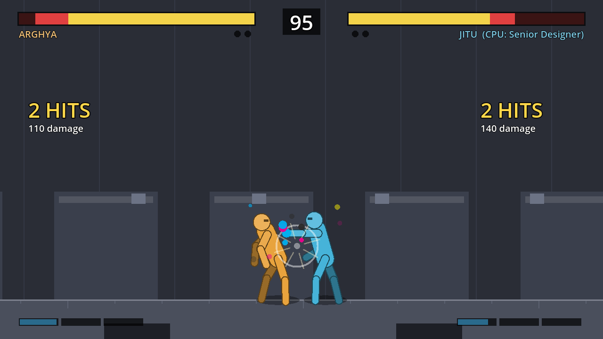

# Quick Fight: Design Team

A 4-fighter browser fighting game: three print-shop designers battle for the big client job, then face their boss.
The design doc is [docs/quick-fight-design.md](docs/quick-fight-design.md).

**Status:** Weeks 1–6. Gray-box prototype plus online play. Arghya and Jitu are placeholder box rigs, and there is one flat stage. Modes: Versus (vs CPU or 2P local), Online (quick match or room code, rollback netcode), Training.
Online results are in [docs/online-prototype.md](docs/online-prototype.md).
Week 1 engine test results are in [docs/week1-engine-test.md](docs/week1-engine-test.md). The title appears in 0.1 s and the game is playable after 7.0 s on emulated 4G, using the slim engine (`tools/`).



## Run it

Requirements: [Godot 4.4.1](https://godotengine.org/download) (standard build, not .NET).

- **Editor:** open `client/project.godot` and press F5.
- **Browser:** install the Web export templates (Editor → Manage Export Templates), then:

```sh
cd client && godot --headless --export-release "Web" ../build/web/index.html
python3 ../tests/web/serve.py ../build/web 8060   # open http://127.0.0.1:8060
```

## Play online locally

Online play works in the Godot editor (Windows, Mac, Linux), using the bundled WebRTC plugin in `client/addons/webrtc_native`. It also works in the browser build. Desktop and browser players can play each other.

```sh
cd server && pip install -r requirements.txt && uvicorn app:app --port 8000   # signaling server (needs Python)
```

- **Two editor windows:** run the game twice from Godot (F5, then Debug → Run Multiple Instances, or launch Godot twice).
- **Browser:** `python3 tests/web/serve.py build/web 8060`, then open http://127.0.0.1:8060.

In each game: Online → pick a fighter → one creates a room, the other joins with the 4-letter code.
The desktop game uses `ws://127.0.0.1:8000/ws` by default. Set the `QF_SERVER` environment variable to use another server.
Add `?lag=75&loss=0.01` to the URL to simulate a bad connection (75 ms each way, 1% loss). To deploy for real, see [infra/README.md](infra/README.md).

## Controls

| Action | Player 1 | Player 2 | Gamepad |
| --- | --- | --- | --- |
| Move / jump / crouch | W A S D | Arrows | Stick / D-pad |
| Light / Heavy Punch | J / K | Numpad 4 / 5 | X / Y |
| Light / Heavy Kick | U / I | Numpad 7 / 8 | A / B |
| Block | Hold back | Hold back | Hold back |
| Throw | LP + LK (close) | | |
| Super / Ultra | HP + HK / Down + HP + HK | | |
| Specials | Forward, down or back + HP or HK. A classic motion (quarter-circle / dragon punch) does +10% damage | | |
| Pause | Esc | | Start |

**Training keys:** F1 hitboxes (works in every mode), F2 infinite meter, F3 dummy behaviour, F4 reset positions, F9 performance overlay.

## Tests

```sh
tests/run.sh            # all sim tests (about 4 s)
tests/run.sh throw      # only tests whose name contains "throw"
```

- `tests/sim/test_data.gd`: every fighter data file loads and follows the rules (whole numbers, full move set, valid cancels).
- `tests/sim/test_rules.gd`: one test per combat rule in the design doc (hit-stop, scaling, counter-hit, cancels, blocking levels, throws, juggles, armor, rounds, timer, finisher, training).
- `tests/sim/test_determinism.gd`: the same 10,000-frame input recording played twice must match every frame; save/restore rollback; sim speed.
- `tests/sim/test_cpu.gd`: the CPU levels finish matches, Art Director beats Intern, and seeded CPU fights replay identically.
- `tests/smoke_ui.gd`: boots the real UI and runs each mode headless.
- `tests/sim/test_rollback.gd`: two rollback sessions over a simulated network (LAN, 150 ms, 20% loss, 400 ms). Every confirmed frame must match.
- `tests/smoke_online.gd`: two online fight screens linked by a fake 150 ms connection.
- `server/test_app.py`: signaling server (rooms, quick match, relaying, TURN credentials). Run with `cd server && python -m pytest`.
- `tests/web/load_test.js`: web build time-to-title under emulated 4G, plus screenshots.
- `tests/online_desktop.sh`: two desktop Godot processes play online through the server with real WebRTC (the plugin).
- `tests/web/online_test.js`: two real browsers play each other through the server over WebRTC with added lag and loss, and check for desyncs and stalls.

## Layout

```
client/            Godot project
  engine/          sim loop, input buffer, state machine, hit detection, CPU (no fighter-specific code)
  fighters/        one folder per fighter: fighter.json (frame data, boxes); _graybox/ = placeholder rig
  stages/          graybox (print_floor, design_studio later)
  ui/              menus, fight screen, HUD, controls
  fx/              shared effects library
  net/             rollback session, WebRTC + signaling connection
  web/             HTML page with the instant title screen
server/            FastAPI signaling / matchmaking
infra/             docker-compose, Caddy, coturn
tools/             slim Godot web engine build, WebRTC plugin version
client/addons/webrtc_native/   official Godot WebRTC plugin (desktop only; vendored by .github/workflows/vendor-webrtc.yml)
docs/              design doc, Week 1 results, screenshots
tests/             sim tests, UI smoke test, web load test
```

## Engineering rules (from the design doc)

- The fight sim is deterministic: whole-number positions and boxes, a fixed 60 ticks/s, and no randomness. The CPU uses its own seeded RNG outside the sim.
- Fighters are data: adding one means adding `fighters/<id>/fighter.json` (format in [client/fighters/README.md](client/fighters/README.md)), with no engine changes.
- The sim never reads the keyboard. It only receives one input bitmask per player per tick (`MatchSim.step(p1, p2)`), which is what rollback netcode will feed it.
- Every merge request runs the tests and a web build (`.github/workflows/ci.yml`), and there are no direct pushes to main.
